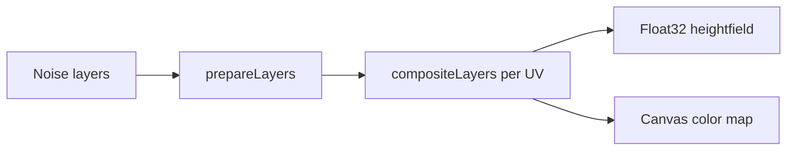

# Noise and fBm

## What

Multi-layer 2D noise compositing builds a heightmap / colormap for topography. Layers support fractal Brownian motion (fBm), cellular noise, shaping (power, terracing), and blend modes.

## Why

A single octave of noise looks blobby. Stacking octaves (fBm) and overlaying ridges / detail layers produces landmass-like heightfields suitable for displacement and erosion.

## How it works

1. Each layer holds type, seed, scale, octaves, opacity, blend mode.
2. `prepareLayers` builds samplers once per apply.
3. `generateHeightfield` / `generateNoiseTexture` sample a square grid with optional map offset for scrolling.

## Code pointers

- [`my-react-app/src/lib/noise.ts`](../my-react-app/src/lib/noise.ts) — noise primitives and layer types
- [`my-react-app/src/lib/generateNoiseTexture.ts`](../my-react-app/src/lib/generateNoiseTexture.ts) — compositing + textures
- [`my-react-app/src/lib/terrainPresets.ts`](../my-react-app/src/lib/terrainPresets.ts) — calibrated landmass preset
- UI: 2D Terrain → Layers in [`SidePanel.tsx`](../my-react-app/src/components/SidePanel.tsx)

## Screenshot

## Related

- [Hydraulic erosion](hydraulic-erosion.md) consumes this heightfield
- Course theme: **Topography**
