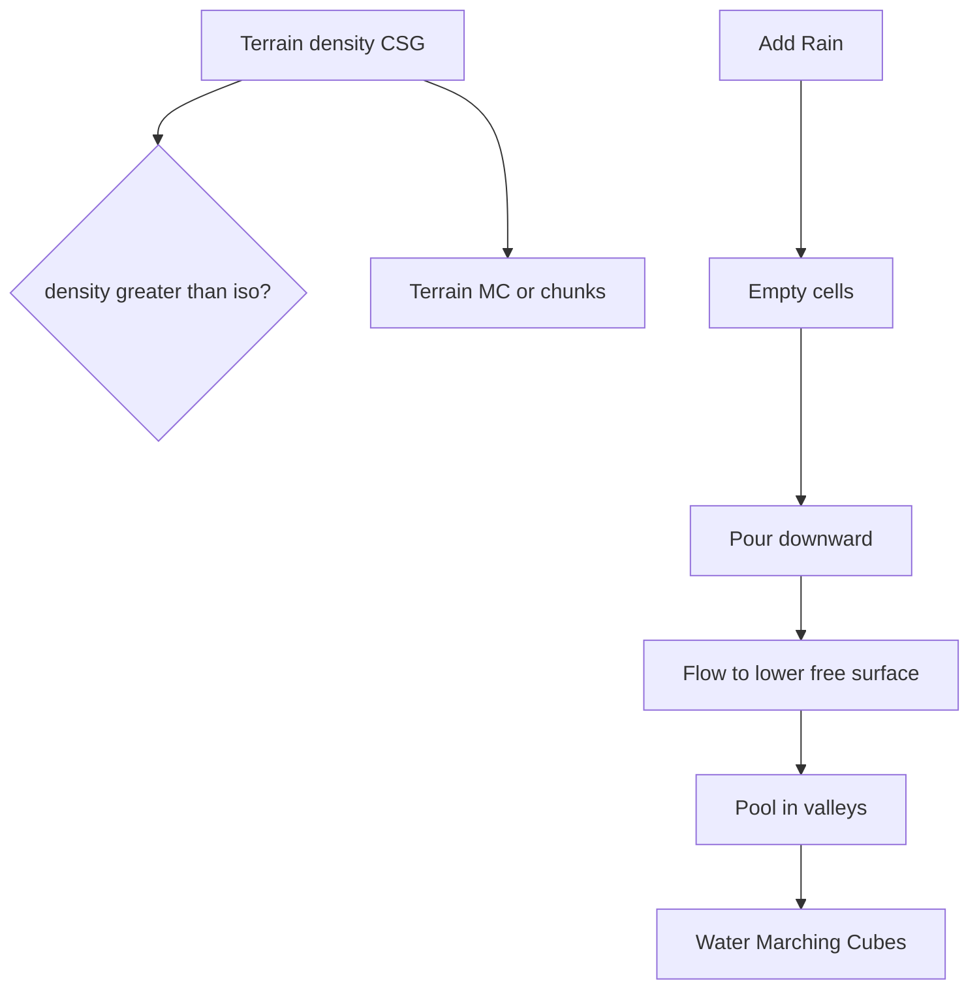

# Voxel hydrology

## What

A second volume on the voxel lattice stores **water amount** per empty cell. Rain adds controllable water; each step applies gravity then lateral flow toward lower free-surface heights; water pools in valleys. Terrain and water are meshed separately with Marching Cubes.

## Why

Class 04 builds density + CSG + MC for solids. Hydrology adds a **3D relationship** between rock and water: lakes sit in depressions carved by the density field, not just a flat heightmap flood fill.

## How it works

1. **Rain** — pick random `(x, z)` columns; add `rainAmount` into the topmost empty sample.
2. **Gravity** — move water into the empty cell below until that cell is full (`water ≤ 1`).
3. **Lateral flow** — compare free-surface `yWorld + fill * spacing` with ±X / ±Z neighbors; transfer `flowRate` of the height difference.
4. **Evaporation** — scale all wet cells by `(1 - evaporation)`.
5. **Meshing** — `waterDensity = water - fillThreshold` (solid terrain forced to `-1`) → `marchingCubes(..., 0)`.

## UI (Voxel Terrain → Hydrology)

| Control | Role |
|---------|------|
| Show Water | Toggle translucent water mesh |
| Rain Amount / Columns | How much water per rain action |
| Flow Rate | Sideways transfer strength |
| Evaporation | Per-step loss |
| Add Rain / Step / Run / Reset | Drive the simulation |
| Total Water | Sum of all cell fills |

Hint: keep resolution ≤ 48³ while running continuous rain.

## Code pointers

- [`my-react-app/src/lib/voxel/hydrology.ts`](../my-react-app/src/lib/voxel/hydrology.ts)
- Wire-up: [`App.tsx`](../my-react-app/src/App.tsx)
- Panel: [`VoxelPanel.tsx`](../my-react-app/src/components/VoxelPanel.tsx)
- Render: [`VoxelCanvas.tsx`](../my-react-app/src/components/VoxelCanvas.tsx) water mesh

## Limits (v1)

- Teaching model, not full shallow-water / Navier–Stokes.
- Water does not erode terrain density.
- Water mesh is unchunked; terrain can stay chunked.
- No custom Fresnel shader yet (Class 05 follow-up).

## Related

- [Density grid](../Data-structures/density-grid.md)
- [Marching Cubes](marching-cubes.md)
- [Hydraulic erosion](hydraulic-erosion.md) (2D heightmap cousin)
