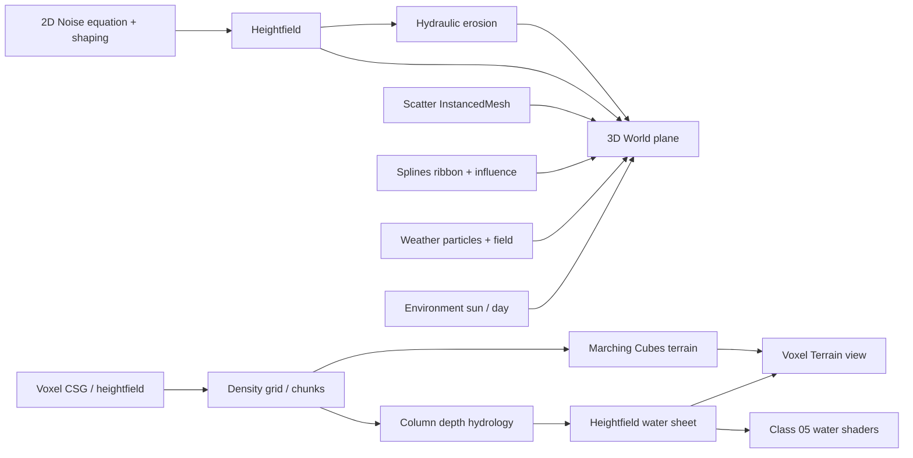

# Project

Notes about the procedural world application: architecture, atmosphere, and deployment.

## Notes

| Note | Topic |
|------|--------|
| [README.md](README.md) | This overview |
| [environment.md](environment.md) | Time of day, sun, day cycle |
| [firebase.md](firebase.md) | Auth, Firestore, Hosting |

## Live sites

| App | URL |
|-----|-----|
| Course world | https://procedural-world-buildin-f602c.web.app |
| Data Fossil | https://pwb-data-fossil.web.app |

## Runnable app

- [../my-react-app/](../my-react-app/) — Vite + React 19 + TypeScript + Three.js ([run](../my-react-app/README.md), [deploy](firebase.md))
- [../data-fossil/](../data-fossil/) — final project, digits → unique rock ([README](../data-fossil/README.md#deploy))

## Architecture (high level)

## Views

| View | Role |
|------|------|
| **3D World** | Displaced plane; Class 06 tabs; Environment + Camera |
| **2D Terrain** | Noise layers + erosion simulation |
| **Voxel Terrain → Field** | Density, CSG, MC, rain / slope flow |
| **Voxel Terrain → Water Shaders** | Deform / contact / ripple / particles |

## Screenshot

### 3D World — Terrain + distributions

Back to [vault README](../README.md).
