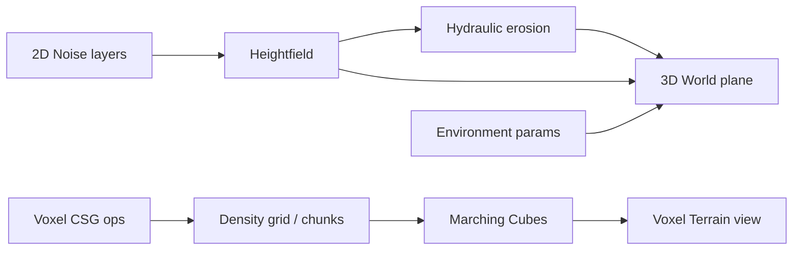

# Project

Notes about the procedural world application itself: architecture, atmosphere, and deployment.

## Notes

| Note | Topic |
|------|--------|
| [README.md](README.md) | This overview |
| [environment.md](environment.md) | Time of day, sun, weather, clouds |
| [firebase.md](firebase.md) | Auth, Firestore, Hosting |

## Runnable app

Source lives next to this vault (not nested under Project, so Firebase paths stay valid):

- [../my-react-app/](../my-react-app/) — Vite + React 19 + TypeScript + Three.js
- Run guide: [../my-react-app/README.md](../my-react-app/README.md)

## Architecture (high level)

## Views

| View | Role |
|------|------|
| **3D World** | Displaced plane, fog, environment, live sync from erosion |
| **2D Terrain** | Noise layers + simulation (erosion) |
| **Voxel Terrain** | Density shapes, CSG, MC mesh / density debug, chunks |

## Screenshot

Back to [vault README](../README.md).
