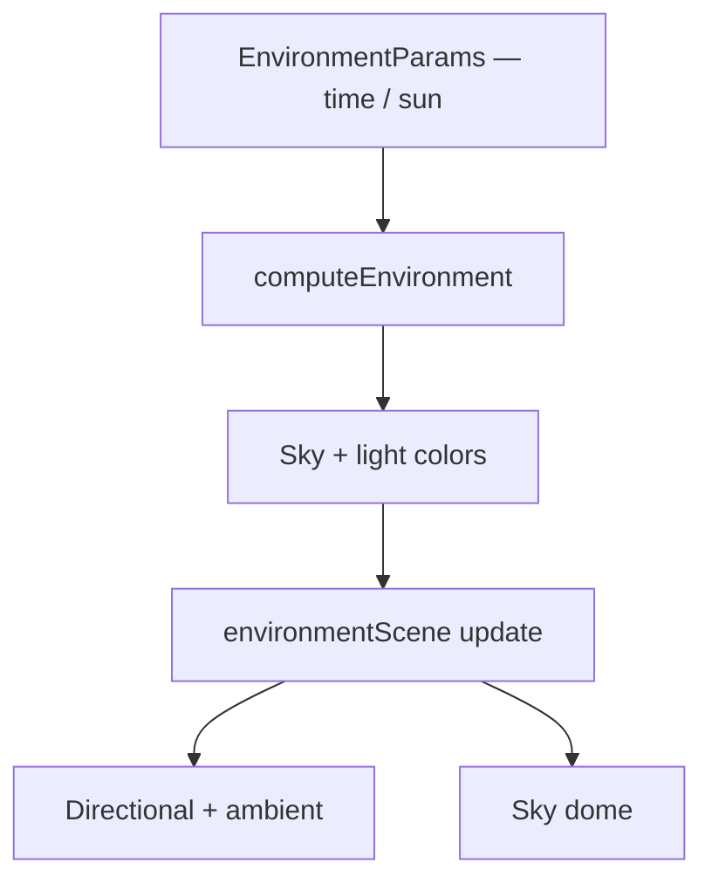

# Environment (Atmosphere)

## What

Time of day, sun direction, and sun intensity for the **3D World** view. Fog / clouds / weather presets were removed from the side panel; weather-like motion now lives under **Particles** (Class 06 A3).

## Why

Atmosphere sells the world as a place, not only a displaced mesh. Keep lighting simple and cheap for a procedural class project; put animated weather in the particle system instead of mesh rain / cloud puffs in the Environment accordion.

## How it works

- Side panel: **Environment** accordion (below Class 06 tabs) → Time of Day, Play Day Cycle, Sun Direction, Sun Intensity.
- **Camera** accordion sits last (reset / store / recall view).
- `computeEnvironment` still accepts legacy weather fields in the type for internal defaults; the UI only exposes time and sun.
- Day cycle can auto-advance time and report back to React state (throttled).

## Code pointers

- [`my-react-app/src/lib/environment.ts`](../my-react-app/src/lib/environment.ts)
- [`my-react-app/src/lib/environmentScene.ts`](../my-react-app/src/lib/environmentScene.ts)
- Wired in [`ThreeCanvas.tsx`](../my-react-app/src/components/ThreeCanvas.tsx) + Environment / Camera in [`SidePanel.tsx`](../my-react-app/src/components/SidePanel.tsx)
- Weather particles: [`lib/particles/`](../my-react-app/src/lib/particles/) · [Class 06 particles note](../Tutorials/Class-06-Distributions/particles-vector-fields.md)

## Screenshot

Environment accordion (time of day / sun) sits under the Class 06 tabs in **3D World**:

## Course theme

**Atmosphere** (lighting) + Class 06 particles for weather motion.

## Related

- [Project overview](README.md)
- [Class 06 — Distributions](../Tutorials/Class-06-Distributions/README.md)
