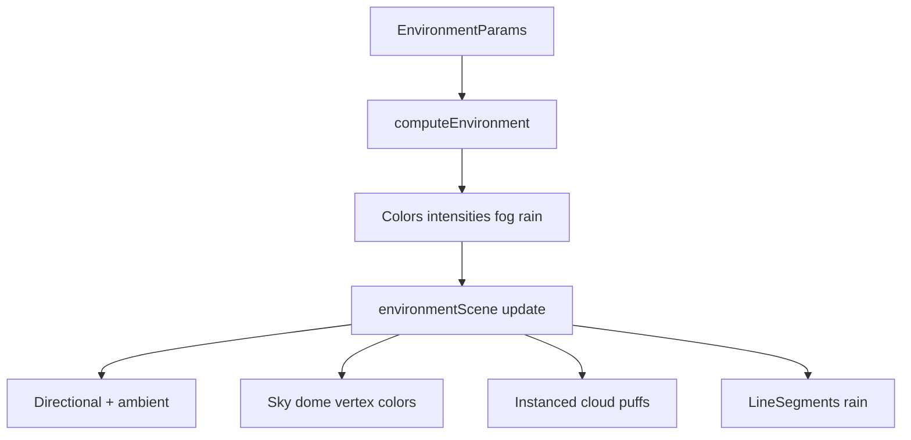

# Environment (Atmosphere)

## What

Time of day, sun direction/intensity, weather (Clear / Cloudy / Rain), and low-poly drifting clouds for the **3D World** view.

## Why

Atmosphere sells the world as a place, not only a displaced mesh. Keep effects simple and cheap for a procedural class project.

## How it works

- `computeEnvironment` maps hour-of-day and weather presets to lighting and sky colors.
- `createEnvironmentScene` owns sky, sun sprite, stars, clouds, rain; reuses the canvas sun/ambient lights and fog.
- Day cycle can auto-advance time and report back to React state (throttled).

## Code pointers

- [`my-react-app/src/lib/environment.ts`](../my-react-app/src/lib/environment.ts)
- [`my-react-app/src/lib/environmentScene.ts`](../my-react-app/src/lib/environmentScene.ts)
- Wired in [`ThreeCanvas.tsx`](../my-react-app/src/components/ThreeCanvas.tsx) + Environment accordion in [`SidePanel.tsx`](../my-react-app/src/components/SidePanel.tsx)

## Screenshot

## Course theme

**Atmosphere** (and related: weather as lightweight visual state).

## Related

- [Project overview](README.md)
