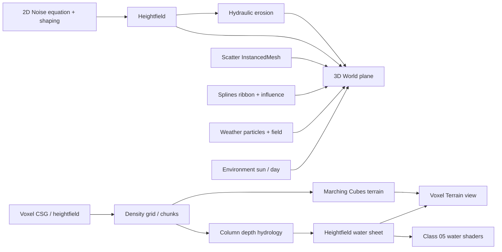
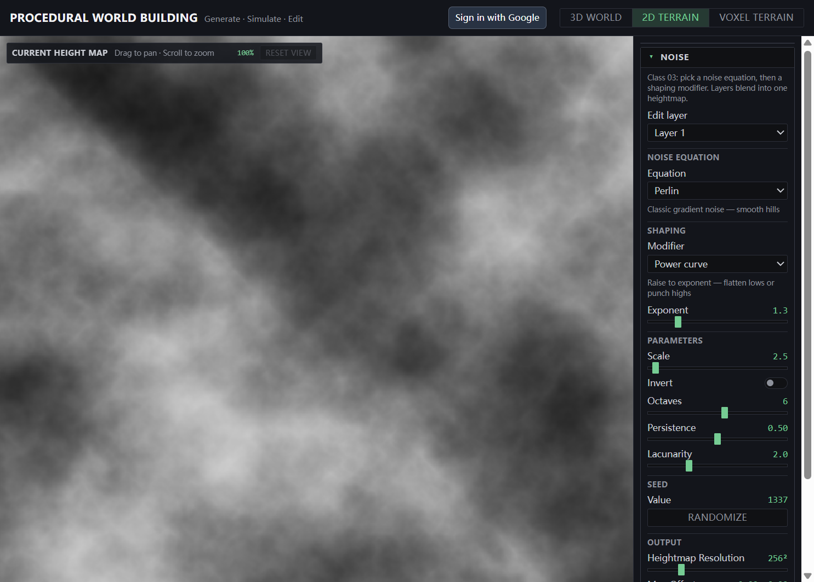
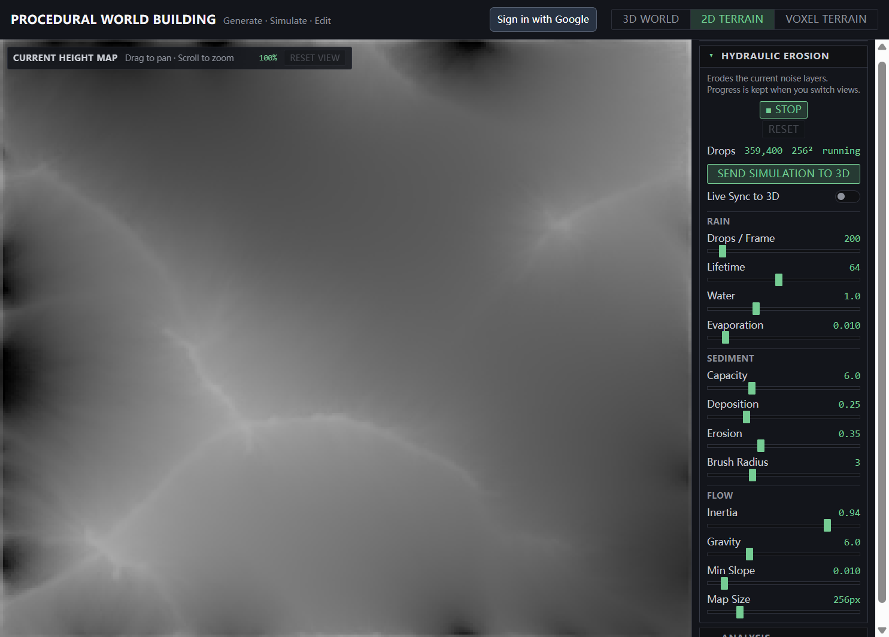
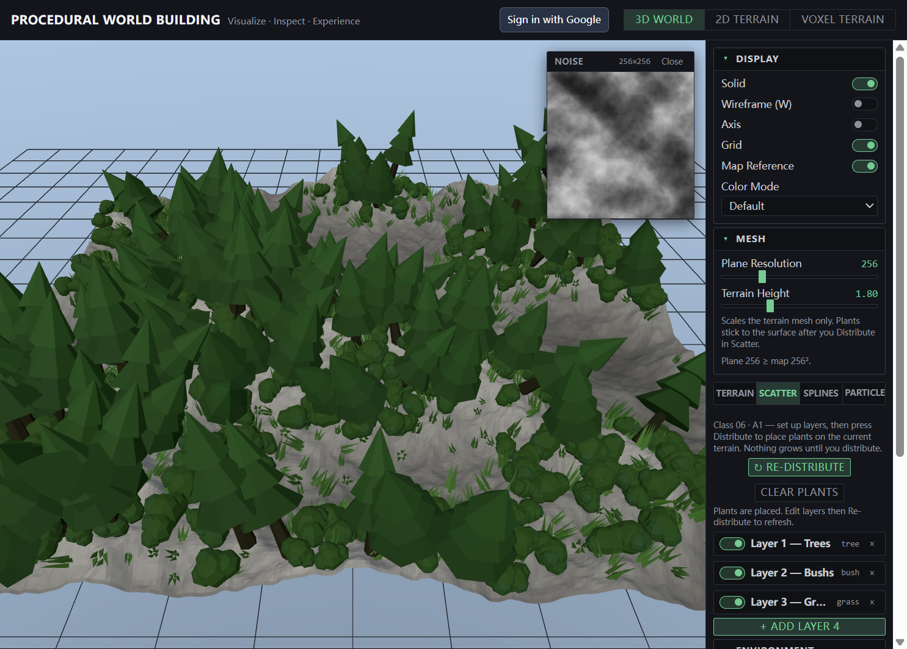

# Procedural World Building

Course app for **DESIGN 6197/4197 — Fall 2026**. Class notes and the in-class Vite + React + Three.js world (`my-react-app/`).

**Live:** https://procedural-world-buildin-f602c.web.app

## Run

```powershell
cd my-react-app
npm install
npm run dev
```

| View | What it covers |
|------|----------------|
| **3D World** | Heightmap mesh + Class 06 tabs (**Terrain → Scatter → Splines → Particles**), then **Environment** and **Camera** |
| **2D Terrain** | Class 03 noise layers (equation + shaping) + hydraulic erosion |
| **Voxel Terrain → Field** | Class 04 density, CSG, Marching Cubes, rain / slope flow |
| **Voxel Terrain → Water Shaders** | Class 05 deform / contact / ripple / particles |

## Architecture



## Tutorials

| Class | Topic |
|-------|--------|
| [01 Terminal](Tutorials/Class-01-Terminal/README.md) | `cd`, Node/npm, run the app |
| [02 Node / React / TypeScript](Tutorials/Class-02-Node-React-TypeScript/README.md) | Toolchain and React + Three UI |
| [03 Noise](Tutorials/Class-03-Noise/README.md) | Equation, shaping, hydraulic erosion |
| [04 Voxel](Tutorials/Class-04-Voxel/README.md) | Density, CSG, Marching Cubes, hydrology |
| [05 Shader](Tutorials/Class-05-Shader/README.md) | Water GLSL |
| [06 Distributions](Tutorials/Class-06-Distributions/README.md) | Scatter, splines, particles |

## Course notes

| Note | What |
|------|------|
| [Firebase](my-react-app/FIREBASE.md) | Auth, Firestore, Hosting |
| [Style](my-react-app/STYLE-GUIDE.md) | UI language |

App code: [my-react-app/README.md](my-react-app/README.md)

## Gallery

### 1. 2D Terrain — Noise



### 2. 2D Terrain — Hydraulic erosion



### 3. 3D World — Terrain + distributions


### 4. Voxel Terrain — Marching Cubes


### 5. Class 06 — Scatter



### 6. Class 06 — Splines


### 7. Class 06 — Particles


