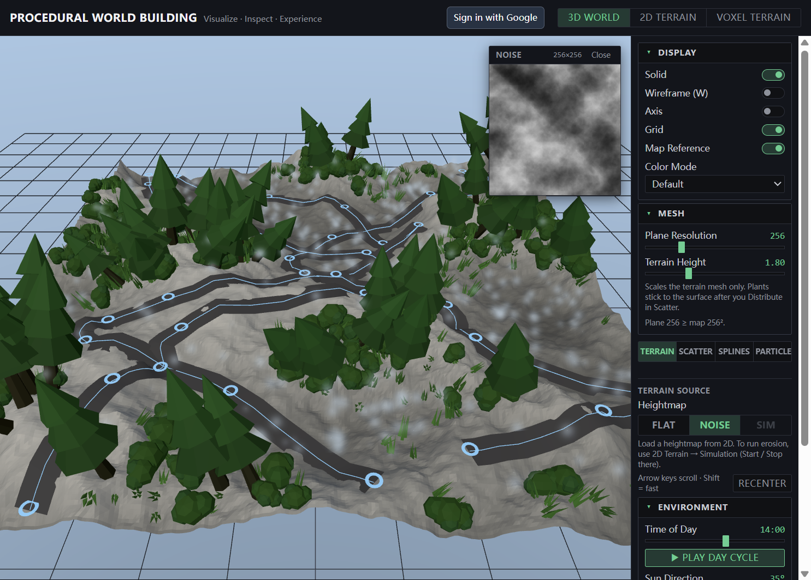
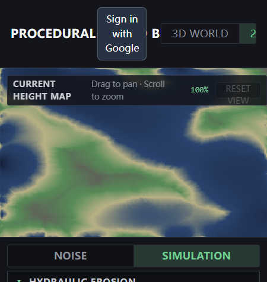
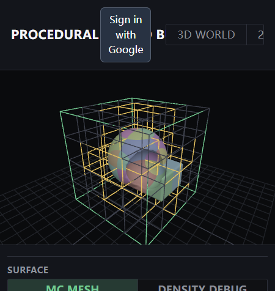
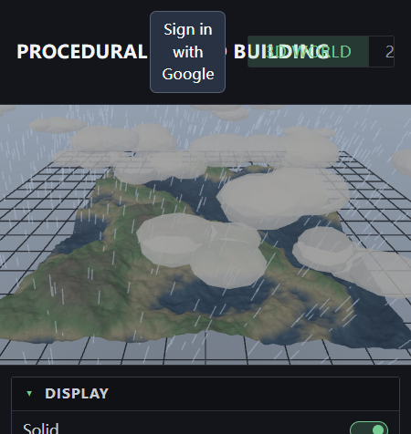

# Procedural World Building

**DESIGN 6197/4197 — Fall 2026** · Documentation vault (DOCS 01: Markdown Vault)

This repository is both a **study notebook** (Obsidian / Markdown) and a runnable **React + Three.js** app under [`my-react-app/`](my-react-app/).

Assignment brief: [`markdown.pdf`](markdown.pdf).

---

## Table of contents

1. [Docs](Docs/README.md) — vault conventions, shared assets
2. [Tutorials](Tutorials/README.md) — React / Three.js how-tos
3. [Algorithms](Algorithms/README.md) — noise, erosion, CSG, Marching Cubes
4. [Data structures](Data-structures/README.md) — density grid, chunking
5. [Shaders](Shaders/README.md) — height gradient shading
6. [Analysis / Critique](Analysis-Critique/README.md) — reflections and open questions
7. [Project](Project/README.md) — architecture, atmosphere, Firebase
8. [Style guides / Design](Style-guides/README.md) — UI style guide
9. [Runnable app](my-react-app/README.md) — install, dev server, build

### Quick links into research notes

| Theme (course) | Notes |
|----------------|--------|
| **Topography** | [Noise & fBm](Algorithms/noise-and-fbm.md), [Hydraulic erosion](Algorithms/hydraulic-erosion.md) |
| **Atmosphere** | [Environment](Project/environment.md) |
| **Volumetric form** | [CSG density](Algorithms/csg-density.md), [Marching Cubes](Algorithms/marching-cubes.md) |
| **Scalable voxels** | [Density grid](Data-structures/density-grid.md), [Chunking](Data-structures/chunking.md) |
| **Shading** | [Height gradient](Shaders/height-gradient.md) |
| **Tool UI** | [Style guide](Style-guides/STYLE-GUIDE.md) |

---

## What was built

A procedural world tool with three views:

| View | Focus |
|------|--------|
| **3D World** | Height-displaced terrain, fog, time of day / weather / clouds, Firebase save of plane params |
| **2D Terrain** | Layered noise authoring + hydraulic erosion simulation, live sync to 3D |
| **Voxel Terrain** | Density shapes, sequential CSG, Marching Cubes, chunked meshes, density debug |

---

## Gallery











---

## How to run the app

```powershell
cd my-react-app
npm install
npm run dev
```

Details: [my-react-app/README.md](my-react-app/README.md) · Firebase: [Project/firebase.md](Project/firebase.md)

---

## Vault folder structure

Matches the course tentative structure (filesystem-safe names):

```text
Docs/
Tutorials/
Algorithms/
Data-structures/
Shaders/
Analysis-Critique/
Project/
Style-guides/
my-react-app/          ← implementation (kept at vault root)
```
