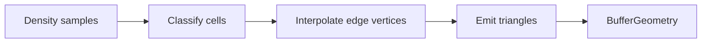

# Marching Cubes

## What

Extracts a triangle mesh where density equals an iso level, using the classic Lorensen / Bourke edge and triangle tables (from three.js `MarchingCubes` addons).

## Why

Voxel density is discrete; MC produces a continuous surface for the Voxel Terrain view with smooth normals (or gradient normals when chunked).

## How it works

1. Each cell has 8 corners; bits mark empty (`density < iso`).
2. `edgeTable` selects crossed edges; `triTable` emits triangles.
3. Vertices are shared along lattice edges.
4. Unchunked path orients triangles using signed volume; chunked path uses gradient normals for seamless seams.

## Code pointers

- [`my-react-app/src/lib/voxel/marchingCubes.ts`](../../my-react-app/src/lib/voxel/marchingCubes.ts) — `marchingCubes`, `marchRegion`
- UI: Iso Level + MC Mesh / Density Debug in [`VoxelPanel.tsx`](../../my-react-app/src/components/VoxelPanel.tsx)
- Render: [`VoxelCanvas.tsx`](../../my-react-app/src/components/VoxelCanvas.tsx)

## Screenshot

## Related

- [Chunking](chunking.md) — per-chunk `meshChunk`
- [Density CSG](csg-density.md)
