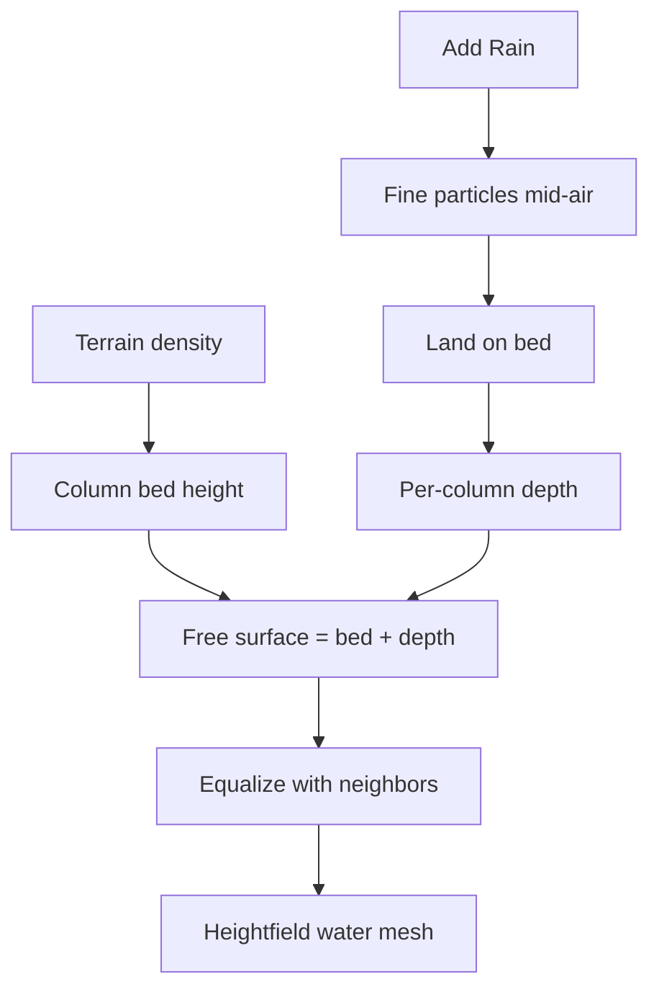

# Voxel hydrology (heightfield)

## What

Water is **not** a 3D voxel stack. Each terrain column stores a **depth** (world units). Fine rain particles fall in continuous space; on contact they add depth. Free-surface equalization (`bed + depth`) drains water downhill so streams follow slopes and ponds form in valleys. The visible water is a **smooth heightfield sheet** (`Y = bed + depth`), not Marching Cubes blocks.

Default terrain is a **voxel-local fBm heightmap** (`source: 'heightfield'`). Switch to **CSG Shapes** for Assignment 1 boolean ops.

## Why

Class 04 builds density + CSG + MC for solids. Hydrology needs a **fluid-looking** relationship to that rock: thin films on slopes, thicker lakes in depressions — without chunky voxel “snow piles.”

## How it works

1. **Rain** — spawn many small particles at random `(x, z)` above the terrain.
2. **Fall** — each tick lowers `y`; when `y ≤ bed`, add `rainAmount` depth to that column.
3. **Slope flow** — for each edge, move depth from higher free surface to lower (flow rate).
4. **Evaporation** — scale all depths by `(1 - evaporation)`.
5. **Meshing** — upsample depth + bed into a continuous triangle sheet (wet cells only).

## UI (Voxel Terrain → Field → Hydrology)

| Control | Role |
|---------|------|
| Show Water | Toggle water sheet |
| Drop Depth | Depth added per landed particle |
| Drop Count | Particles per Add Rain |
| Flow Rate | How strongly surfaces equalize |
| Evaporation | Per-step loss |
| Add Rain / Step / Run / Reset | Drive the simulation |
| Total Water | Sum of depths (+ in-flight drops) |

Hint: keep resolution ≤ 48³ while running continuous rain.

## Code pointers

- Sim + mesh: [`hydrology.ts`](../../my-react-app/src/lib/voxel/hydrology.ts)
- Wire-up: [`App.tsx`](../../my-react-app/src/App.tsx)
- Panel: [`VoxelPanel.tsx`](../../my-react-app/src/components/VoxelPanel.tsx)
- Render: [`VoxelCanvas.tsx`](../../my-react-app/src/components/VoxelCanvas.tsx)

## Limits (v1)

- Teaching shallow free-surface model, not full Navier–Stokes.
- Water does not erode terrain density.
- Water sheet is unchunked; terrain can stay chunked.

## Related

- [Density grid](density-grid.md)
- [Marching Cubes](marching-cubes.md) (terrain only)
- [Hydraulic erosion](../Class-03-Noise/hydraulic-erosion.md) (2D heightmap cousin)
- [Class 05 shaders](../Class-05-Shader/README.md) (GLSL on this water sheet)

Back to [Class 04 README](README.md).
