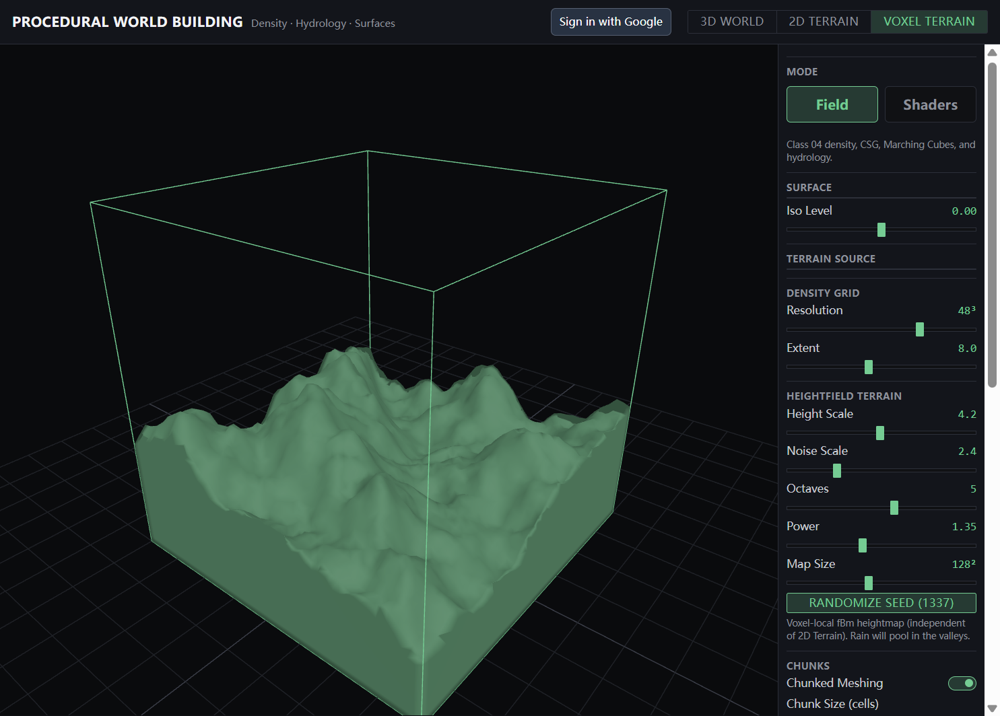

# Class 05 — Shader (mesh deformation)

**Status:** learning · **Area:** shading / water

## In one breath

GPU shaders run on a **free-surface water mesh** over voxel terrain — deform, depth/contact foam against the heightmap, click ripples, and soft rain particles — inside **Voxel Terrain → Water Shaders**.

## Why it exists in this project

Class 05 (*PCG 03: Shaders*) asks for swappable shader studies. They share the voxel scene with Class 04 hydrology: water is a free surface that **collides** with terrain (depth / discard), not a skin glued to the mountain.

## How it works (my words)

1. Open **Voxel Terrain** → **Water Shaders**.
2. Swap: **Deform | Contact | Ripple | Particles**.
3. With no rain yet: a **valley water table** (horizontal level cut by terrain).
4. After **Add Rain**: the heightfield hydro sheet becomes the shader target.
5. Contact uses a **terrain height texture**; fragment depth = `waterY − bedY`.

## Notes in this class folder

| Note | What it covers |
|------|----------------|
| [shader-studies.md](shader-studies.md) | Four strategies, GLSL pointers |
| [height-gradient.md](height-gradient.md) | CPU height LUT on 3D terrain (related) |

## Strategies (Assignment 2)

| Strategy | Idea |
|----------|------|
| **Deform** | Vertex displacement (sine + noise) on free-surface water |
| **Contact** | Depth tint + shore foam vs voxel heightmap |
| **Ripple** | Click water → radial waves in the vertex shader |
| **Particles** | Falling rain points + deformed water mesh |

## Screenshot



## Key terms

| Term | Meaning |
|------|---------|
| **Vertex shader** | Per-vertex — mesh deformation / ripples |
| **Fragment shader** | Per-pixel — depth tint / foam / discard under rock |
| **Heightmap contact** | `DataTexture` of column tops from the density grid |
| **Water table** | Horizontal demo lake when hydro is empty |
| **Uniform** | Values React pushes into GLSL (`uTime`, `uHeightMap`, …) |

## Related

- Previous: [Class 04 — Voxel](../Class-04-Voxel/README.md)
- Next: [Class 06 — Distributions](../Class-06-Distributions/README.md)
- Hydrology sheet: [voxel-hydrology.md](../Class-04-Voxel/voxel-hydrology.md)
- Code: [`waterMaterial.ts`](../../my-react-app/src/lib/shaders/waterMaterial.ts), [`terrainHeightTexture.ts`](../../my-react-app/src/lib/shaders/terrainHeightTexture.ts), [`demoWaterSheet.ts`](../../my-react-app/src/lib/shaders/demoWaterSheet.ts), [`VoxelCanvas.tsx`](../../my-react-app/src/components/VoxelCanvas.tsx)
