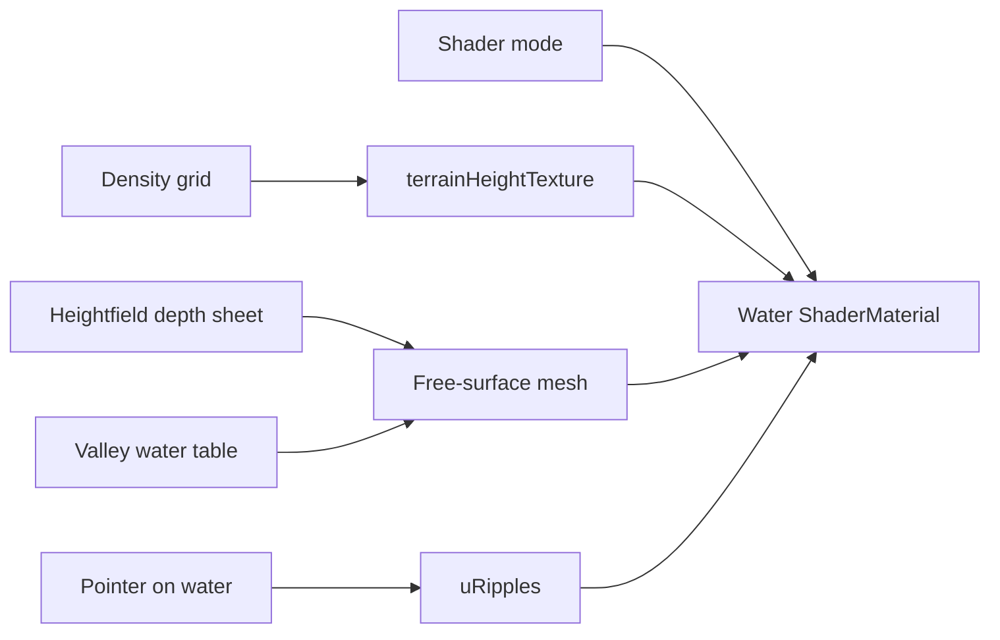

# Shader studies (Class 05)

## What

**Water Shaders** workspace inside **Voxel Terrain**: four swappable strategies (Assignment 2) — mesh deformation, depth + terrain contact foam, click ripples, and soft particles beside the water mesh.

## Why

Class 05 shows contact foam and vertex displacement on water. The mesh is a **free surface** (hydro heightfield sheet or valley water table). Terrain collision comes from sampling the density heightmap — not from draping water onto every mountain face.

## Strategies

| Mode | Class 05 link | Technique |
|------|---------------|-----------|
| **Deform** | p22–24 | Vertex `position.y` += sine + noise; clamp above bed |
| **Contact** | p19–20, p23–24 | Fragment depth tint + foam; discard where under rock |
| **Ripple** | surface ripple | Click → raycast → up to 4 timed radial waves |
| **Particles** | extension | Falling rain `Points` + deformed water mesh |

## How it works

1. **Deform** — `uTime`, amplitude, frequency, speed drive vertex height; normals from finite differences.
2. **Contact** — `depth = waterY − bedHeight(uHeightMap)`; shallow → foam; `depth < ε` → discard.
3. **Ripple** — click writes `(x, z, startTime, strength)` into `uRipples[4]`.
4. **Particles** — Class 04 rain drops + water shader in one scene.

## Code pointers

- Types: [`types.ts`](../../my-react-app/src/lib/shaders/types.ts)
- Water GLSL: [`waterMaterial.ts`](../../my-react-app/src/lib/shaders/waterMaterial.ts)
- Height texture: [`terrainHeightTexture.ts`](../../my-react-app/src/lib/shaders/terrainHeightTexture.ts)
- Valley table: [`demoWaterSheet.ts`](../../my-react-app/src/lib/shaders/demoWaterSheet.ts)
- Viewport: [`VoxelCanvas.tsx`](../../my-react-app/src/components/VoxelCanvas.tsx)
- Panel: [`ShaderPanel.tsx`](../../my-react-app/src/components/ShaderPanel.tsx) via VoxelPanel

## Related

- [Voxel hydrology](../Class-04-Voxel/voxel-hydrology.md)
- Class 05 PDF — Contact Shaders, Vertex displacement, Assignment 2

Back to [Class 05 README](README.md).
