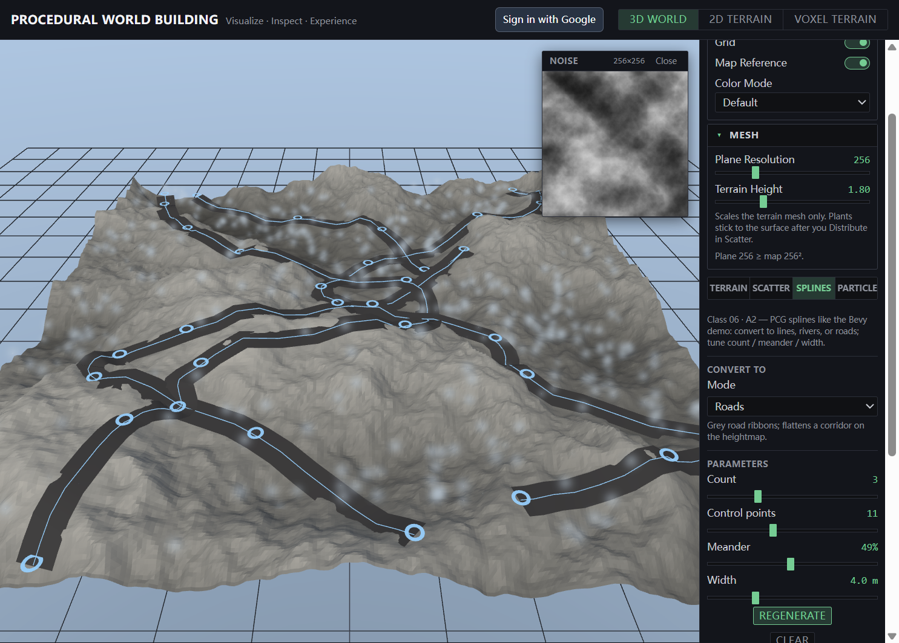
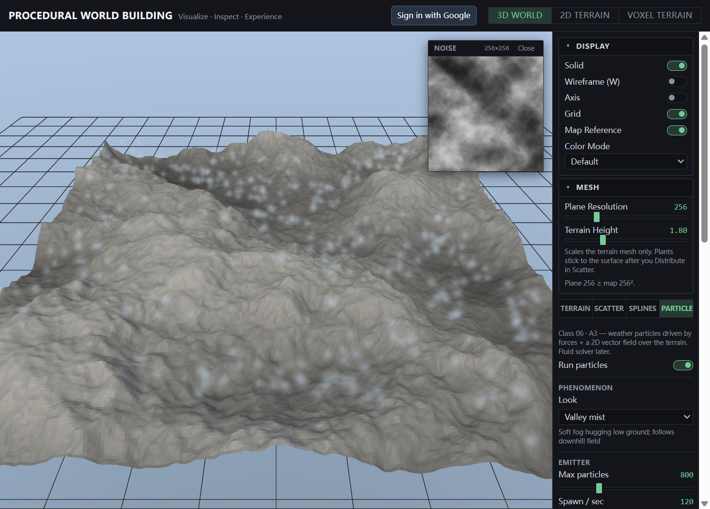

# Class 06 — Distributions (scatter, paths, particles)

**Status:** ready · **Area:** populating the world  
**Course:** *PCG 04: Distributions / Paths / Vector Fields & Particles* (Jose Sanchez)

## In one breath

After terrain, voxels, and water shaders exist, Class 06 places **many things** on that surface: scatter plant layers, draw **spline paths** (roads / rivers) onto the mesh, and drive **weather particles** with 2D vector fields and trails.

## Why it exists in this project

Classes 01–05 build form and surface. A procedural world still looks empty until vegetation, routes, and atmospheric motion appear. These three assignments bridge “terrain engine” to “inhabited landscape.”

## How it maps to the app

Top bar stays **3D World | 2D Terrain | Voxel**. Class 06 lives under **3D World** as four sticky sub-tabs, then **Environment** and **Camera** as always-visible accordions below:

| Sub-tab | Assignment | Status |
|---------|------------|--------|
| **Terrain** | Heightmap source (Flat / Noise / Sim), Display, Mesh | Ready |
| **Scatter** | A1 — plant layers + slope / height rules | Ready |
| **Splines** | A2 — Convert To / meander / ribbon + flatten·carve | Ready |
| **Particles** | A3 — weather presets, vector field, trails | Ready |

## Screenshots

### Scatter — plant layers

### Splines — roads / control points

### Particles — weather + vector field

## Notes in this class folder (three assignments)

| Note | Assignment | What it covers |
|------|------------|----------------|
| [scattering.md](scattering.md) | **1 — Scattering** | Layered assets, masks, InstancedMesh |
| [paths-splines.md](paths-splines.md) | **2 — Paths** | UV Catmull-Rom → heightfield → ribbon + influence |
| [particles-vector-fields.md](particles-vector-fields.md) | **3 — Particles** | Weather particles, 2D vector fields, trails |

## Course techniques (from the deck)

**Scattering:** random → noise distribution → asset differentiation following maps → orient to surface → respect max slope (e.g. 33°).

**Paths:** spline overlays for roads / rivers; lines projected onto terrain; path and mesh can influence each other.

**Vector fields & particles:** point data, sprites, forces (wind / vortex), vector fields, trails (no full fluid solver).

## Key terms

| Term | Meaning |
|------|---------|
| **Scatter / populate** | Automatically place many asset copies on a surface |
| **Control layer / mask** | Map that allows or forbids a given asset type |
| **Spline overlay** | Curve used as road, river, or path detail on terrain |
| **Vector field** | Direction (and often strength) defined at every point in space |
| **Particle system** | Many points updated over time (forces, lifetime, trails) |

## Related

- Final project (scatter layers, particles, orbit paths): [Data Fossil](../../data-fossil/README.md)
- Previous: [Class 05 — Shader](../Class-05-Shader/README.md)
- Terrain masks: [Class 03 — Noise](../Class-03-Noise/README.md), [Class 04 — Voxel](../Class-04-Voxel/README.md)
- Atmosphere notes: [../../Project/environment.md](../../Project/environment.md)
- Slides: `jose课件/PWB - Class 06.pdf`

Back to [Tutorials](../README.md)
