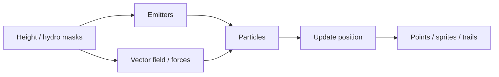

# Assignment 3 — Particles & vector fields

## What

Implement a **particle system** for phenomena that have **no fixed geometry** — atmosphere, water spray, clouds, dust. Drive particles with **forces** and/or a **vector field**. Explore **trails** and creative representations (points, sprites, ribbons).

## Why

Scatter and splines are mostly static placement. Weather and flow need many short-lived samples moving through space. Vector fields give coherent motion (wind corridors, vortex, downhill mist) without simulating full fluids first.

## Course techniques (Class 06)

| Technique | Idea |
|-----------|------|
| **Point data** | Particles as positions (and velocity, age, size) over space |
| **Sprites** | Billboard textures (flake, puff, spark) |
| **Forces** | Wind, gravity, vortex, attractors |
| **Vector fields** | Sample a direction grid / noise curl to update velocity |
| **Fluid-style** | Optional: particle motion inspired by a fluid solver |
| **Trails** | Leave a fading path behind each particle |

## Assignment brief (from the deck)

1. Implement a particle system in the simulation.
2. Calibrate it for **weather / phenomena without fixed geometry** (atmosphere, water, clouds).
3. Explore particles inside **vector fields**.
4. Explore how particles can **draw trails**.
5. Explore creative ways to **represent** the system.

## Design protocol (study checklist)

| Question | Example |
|----------|---------|
| Phenomenon? | Mist in valleys, spray at shores, snow drift, cloud puffs, pollen |
| Birth / death? | Spawn rate, lifetime, fade |
| Forces? | Gravity + wind; vortex; curl noise field |
| Field source? | 2D wind map on terrain, 3D noise, downhill of height gradient |
| Look? | Points, soft sprites, short Line trails, GPU points shader |
| Tie to world? | Spawn denser near water (hydro), or on steep windward slopes |

## How it plugs into this app

- **UI:** **3D World → Particles** — Run particles, phenomenon presets, count / lifetime / size, field mode, trails, optional field arrows.
- **Field:** coarse 2D vector grid (downhill −∇height, wind, vortex, curl noise); each frame velocity samples the field.
- **Look:** soft point sprites + optional short trail LineSegments (no full fluid solver).
- **Environment:** lighting stays in [atmosphere.md](atmosphere.md); weather motion lives here, not in Fog/Clouds UI.

## Suggested acceptance criteria

- [x] Particle system running in the app (spawn, update, die)
- [x] Calibrated toward one weather / atmospheric look
- [x] Motion influenced by at least one force **or** sampled vector field
- [x] One creative representation choice (sprites **or** trails **or** custom shader points)
- [x] Short note on how the field relates to terrain / water / wind

## In this app (3D World → Particles)

1. Optionally **Send to 3D** a Noise heightmap (valley mist / downhill field work better with terrain).
2. Open **Particles**, enable **Run particles**.
3. Pick a phenomenon: Valley mist / Snow / Pollen / Shore spray (presets tune field + forces).
4. **Vector field:** Downhill (−∇height), constant wind, vortex, or curl noise — sample each frame to steer velocity.
5. **Trails:** short LineSegments ring buffer per particle; soft additive point sprites for the body.
6. **Show field arrows** to visualize the grid. Fluid solver is intentionally out of scope for now.

## Related

- Previous: [paths-splines.md](paths-splines.md)
- Lighting: [atmosphere.md](atmosphere.md)
- Rain / water points: [voxel-hydrology.md](../Class-04-Voxel/voxel-hydrology.md), [shader-studies.md](../Class-05-Shader/shader-studies.md)
