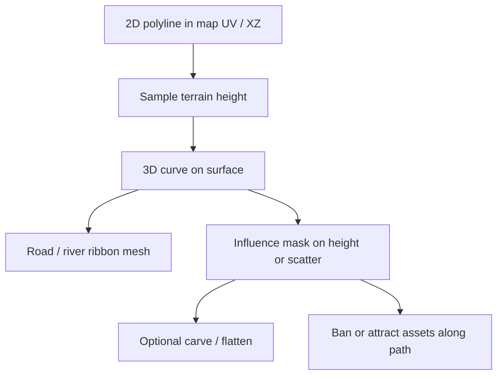

# Assignment 2 — Paths / spline overlays

## What

Use **splines** (2D or 3D curves) as an overlay layer for features that are naturally **lines**: roads, rivers, trails, ridgelines. Project those lines onto the 3D terrain mesh and decide how the spline and the mesh **influence** each other.

## Why

Scatter fills areas. Paths connect places. Splines are a compact way to author routes that stay editable while still conforming to (or carving) the terrain.

## Course techniques (Class 06)

| Technique | Idea |
|-----------|------|
| **Spline overlays** | Curves add detail such as roads or rivers on top of the base terrain |
| **2D → 3D projection** | Draw or generate a polyline in map space, lift it onto the heightfield / mesh |
| **Mutual influence** | Path follows terrain height — or terrain is flattened / carved along the path |

## Assignment brief (from the deck)

1. Consider what a **spline layer** is for.
2. What can be represented as **lines**?
3. How can **2D lines** be projected onto a **3D surface / terrain mesh**?
4. What is the **influence** of a spline on a mesh — or the mesh on the spline?

## Design protocol (study checklist)

| Question | Options to explore |
|----------|--------------------|
| What is the line? | Road, river, trail, fence, power line, ridgeline hiking path |
| Authoring | Click-to-draw polyline, noise ridge skeleton, connect POIs |
| Projection | Sample height under each point; optional slight lift above ground |
| Mesh → spline | Snap points to surface; slope-aware smoothing |
| Spline → mesh | Flatten a corridor, carve a river trench, paint a road texture mask |
| Width | Constant, or vary with terrain (narrow on ridges, wide in valleys) |

## How it plugs into this app

- **Authoring:** **3D World → Splines** — Convert To (Spline / Rivers / Roads), Count, Control points, Meander, Width, Regenerate.
- **Projection:** UV Catmull-Rom in map space → sample heightfield → 3D curve on the surface.
- **Ribbon mesh:** extrude a strip along the tangent (roads grey / rivers blue).
- **Influence:** flatten (roads) or carve (rivers) the heightfield corridor; scatter auto-avoids those masks.

## Suggested acceptance criteria

- [x] At least one editable or generated spline visible in 3D
- [x] Clear 2D→3D projection onto the terrain surface
- [x] Documented influence in at least one direction (mesh follows path **or** path follows mesh **or** both)
- [x] One concrete line type chosen (road *or* river *or* trail) with width / material

## In this app (3D World → Splines)

Bevy-style PCG panel:

1. Send a Noise (or Sim) heightmap to 3D.
2. Open **Splines**.
3. **Convert to:** Spline only (cyan lines + control rings) / Rivers (blue ribbon + carve) / Roads (grey ribbon + flatten).
4. **Count · Control points · Meander · Width** — then **Regenerate**.
5. Clear restores the pre-edit heightmap. Scatter auto-avoids road/river corridors.

## Related

- Previous: [scattering.md](scattering.md)
- Next: [particles-vector-fields.md](particles-vector-fields.md)
- Height sampling: [Class 03](../Class-03-Noise/README.md)
