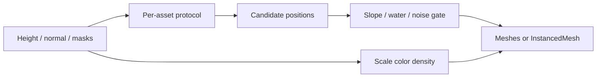

# Assignment 1 — Scattering / populating

## What

Build a **scattering system** that places different assets on the terrain (trees, rocks, bushes, windmills, etc.). Each asset type gets its own **control layer** and spawn rules. Instances should vary with terrain data (size, density, leaf color, …).

## Why

A heightmesh alone reads as bare geology. Scattering turns the same height / slope / moisture data into an ecosystem of props without hand-placing every object.

## Course techniques (Class 06)

| Technique | Idea |
|-----------|------|
| **Random** | Uniform random samples on the surface (baseline) |
| **Noise distribution** | Use noise to cluster or thin placements |
| **Following maps** | Different assets follow different terrain masks (height, biome, moisture) |
| **Oriented to surface** | Align instance up-vector to terrain normal |
| **Slope limit** | Reject slopes steeper than a max angle (deck example: **33°**) |

## Assignment brief (from the deck)

1. Develop a scattering system that populates the terrain with **different assets**.
2. Create **layers** that control each asset type. Decide a protocol: Do assets avoid cliffs? Appear near water?
3. Add **variation** driven by terrain data (leaf coloration, size, density, …).

## Design protocol (study checklist)

For each asset layer, write down:

| Question | Example |
|----------|---------|
| Where is it allowed? | Height band, max slope, distance to water |
| How dense? | Samples per area, noise threshold |
| How oriented? | Align to normal? Y-up only? Random yaw? |
| How varied? | Scale from height, color from moisture / noise |
| What does it avoid? | Cliffs, roads (later spline mask), other assets |

## How it plugs into this app

1. **3D World** → sub-tab **Terrain** → Heightmap **Noise** / **Sim** (or Scatter → **Use Noise map**).
2. Sub-tab **Scatter** — Layers 1–3 (tree / bush / grass) spawn on **high / mid ground**; river valleys stay clear.
3. **+ Add Layer N** for more stacks; tune density, max slope, height band, noise gate, align-to-slope.

| Piece | Code |
|-------|------|
| Layer types | [`types.ts`](../../my-react-app/src/lib/scatter/types.ts) |
| Procedural plants | [`plantMeshes.ts`](../../my-react-app/src/lib/scatter/plantMeshes.ts) |
| Sampling / rules | [`scatterPlants.ts`](../../my-react-app/src/lib/scatter/scatterPlants.ts) |
| InstancedMesh | [`ThreeCanvas.tsx`](../../my-react-app/src/components/ThreeCanvas.tsx) |
| UI | [`SidePanel.tsx`](../../my-react-app/src/components/SidePanel.tsx) |

## Acceptance criteria

- [x] ≥ 2 asset types with separate control layers (tree, bush, grass)
- [x] Max slope (default 33° for trees) + height band + optional near-valley
- [x] Scale / leaf tint from height + noise
- [x] Align to terrain normal (toggle)

## Related

- Next: [paths-splines.md](paths-splines.md)
- Masks: [noise-and-fbm.md](../Class-03-Noise/noise-and-fbm.md), [voxel-hydrology.md](../Class-04-Voxel/voxel-hydrology.md)
