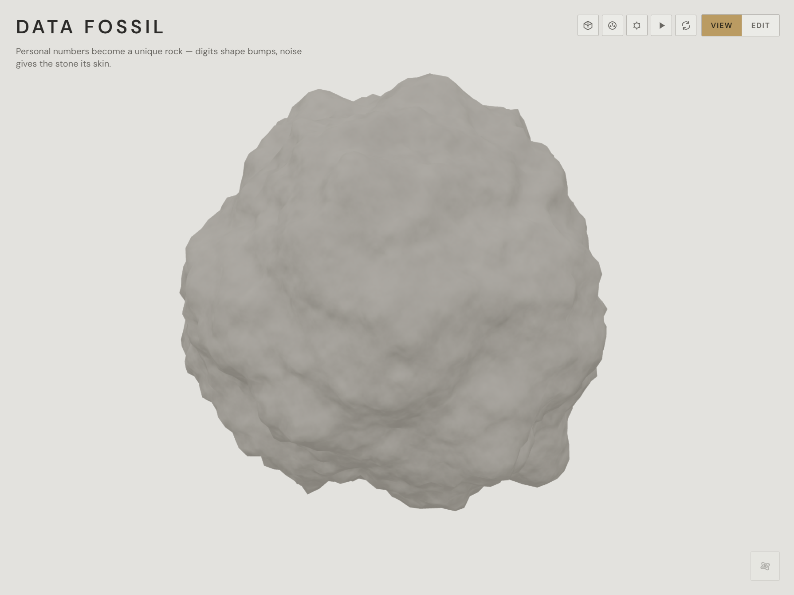
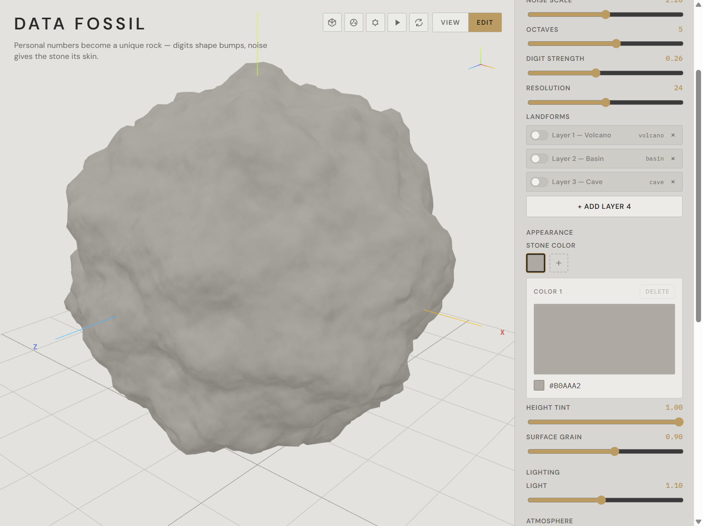
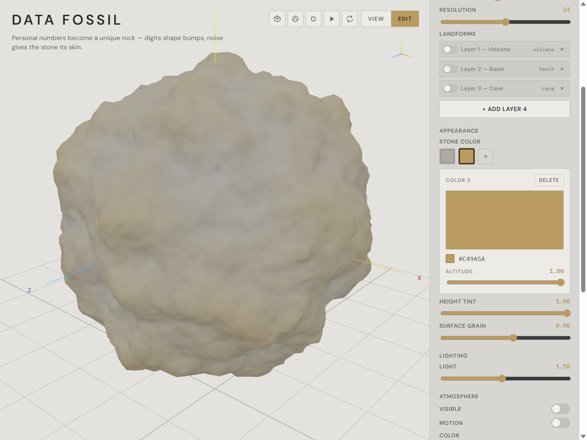
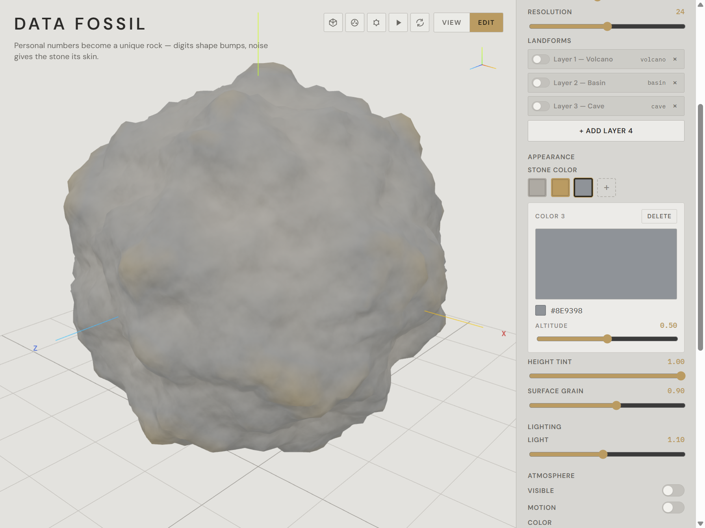
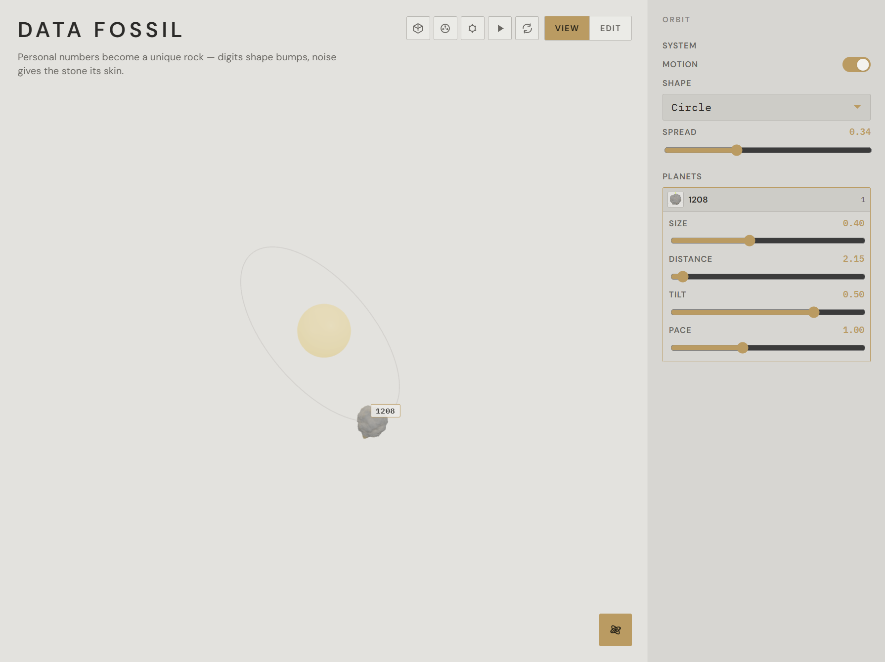

# Data Fossil

An interactive 3D web project: a number you care about becomes a unique digital rock.

**Live:** https://pwb-data-fossil.web.app

---

## Concept

Data Fossil explores how digital information persists over time through the metaphor of rock.

Rock represents deep geological time, while digital information can be instantly refreshed, overwritten, or deleted. Yet once information is uploaded to the cloud or stored on a hard drive or in a database, it can seem to acquire an almost “eternal” life. This apparent permanence raises a question: how does digital information ultimately exist, especially after its original purpose or context has disappeared?

The project approaches this question through personally meaningful numbers, such as phone numbers, birthdays, and house numbers. These sequences connect us to people, places, and periods of our lives. A relationship may end, or we may leave a home, while the numbers remain in our memory and digital records.

Visitors enter a number sequence to generate a digital rock. Individual digits shape its geometry, while procedural noise creates an irregular surface. The rock becomes a digital fossil: a lasting trace of information whose personal meaning may change or fade.

By bringing geological time into a digital medium, Data Fossil questions the promise of digital eternity and explores what survives when data remains, but its meaning is no longer accessible.

---

## How to use

**View** — the rock spins; there is no editor. Bottom-right: look around inside the stone, or open a stellar system of saved fossils.

**Edit** — palette on the right: digits, noise, landforms (volcano / basin / cave), stone colors, light, and atmosphere particles.

**Generate** — applies the typed digits and resets shape, color, landforms, light, and atmosphere so you start from a clean planet.

**Save** — stores a thumbnail in the tray (max 12). Click a thumbnail to load that fossil. **Export STL** downloads the mesh.

Reload the page to return to the default **1208** rock. Saved fossils stay in the tray; they are not applied until you click one.

---

## Gallery

All shots use the default seed **1208**. Color is added one swatch at a time.

### 1. View — base rock



### 2. Edit — first color (#B0AAA2)



### 3. Second color



### 4. Third color



### 5. Stellar system

Saved fossils orbit a star.



---

## Run locally

```powershell
cd data-fossil
npm install
npm run dev
```

Open **http://localhost:5173/**

---

## Deploy

Data Fossil is a static Firebase Hosting site on the same project as the course world (`procedural-world-buildin-f602c`), but a **second site**, so it does not overwrite https://procedural-world-buildin-f602c.web.app.

Hosting config lives in this folder: [`firebase.json`](firebase.json) and [`.firebaserc`](.firebaserc). Site id: `pwb-data-fossil`. No Auth or Firestore.

### After you change the code

```powershell
cd data-fossil
npm run build
firebase deploy --only hosting
```

The live URL stays **https://pwb-data-fossil.web.app**.
