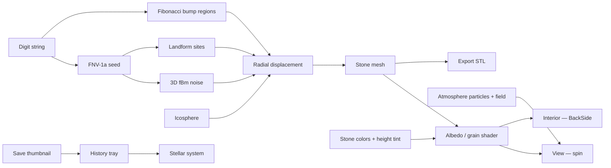
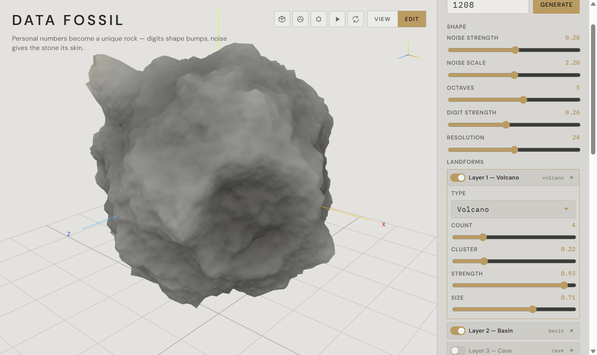
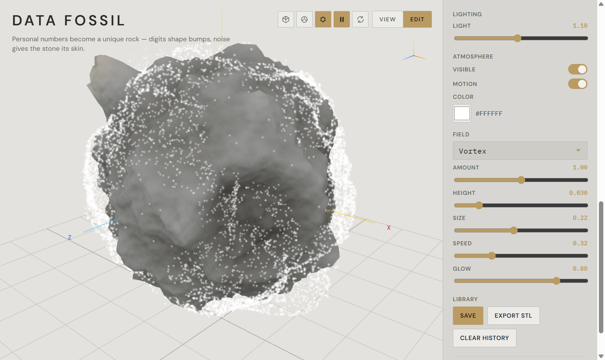
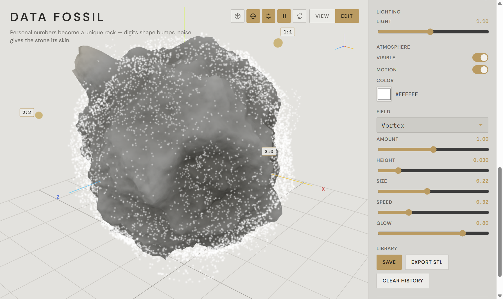
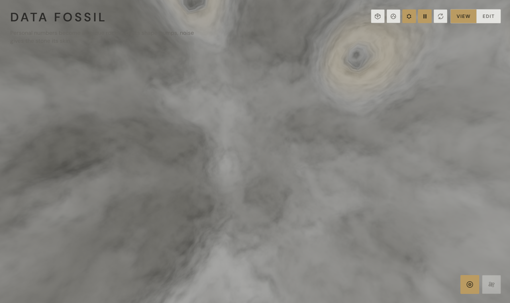
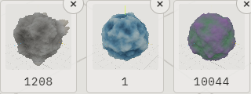
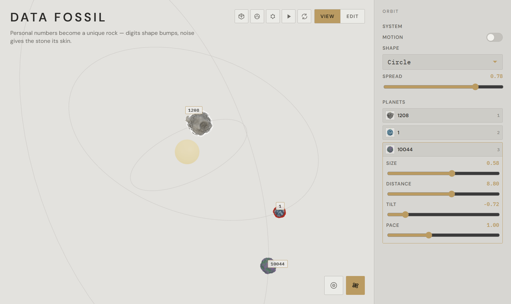

# Data Fossil

Final project for **DESIGN 6197/4197 — Fall 2026**. A number you care about becomes a unique digital rock.

**Live:** https://pwb-data-fossil.web.app

## Run

```powershell
cd data-fossil
npm install
npm run dev
```

| Mode | What it covers |
|------|----------------|
| **View** | Rock spins; no editor. Bottom-right: interior panorama, or stellar system (after Save) |
| **Edit** | Right palette: digits, noise, landforms, stone colors, light, atmosphere |
| **Interior** | Camera inside the mesh (`BackSide`); look around the stone cavity |
| **Stellar system** | Saved fossils orbit a star; orbit palette on the right |

Toolbar (top-right): wireframe, digit mapping overlay, particles on/off, play/pause, reset camera.

## Architecture



Digits (0–9, up to 16, leading zeros count) hash to a seed. Each digit sits on a Fibonacci spiral and pushes the shell by `(d/9) × digit strength`. 3D fBm wrinkles the skin; volcano / basin / cave layers add local radial landforms. Color is a height LUT (Class 05) mixed with 3D-noise mottling. Atmosphere is Class 06 particles on a vortex / curl / wind field.

**Generate** applies the typed digits and resets shape, color, landforms, light, and atmosphere to the default planet. **Save** stores a thumbnail (max 12). Click a tray tile to load that fossil. Reload the page to return to **1208**; saved fossils stay in the tray until you click one.

## Concept

Data Fossil explores how digital information persists over time through the metaphor of rock.

Rock represents deep geological time, while digital information can be instantly refreshed, overwritten, or deleted. Yet once information is uploaded to the cloud or stored on a hard drive or in a database, it can seem to acquire an almost “eternal” life. This apparent permanence raises a question: how does digital information ultimately exist, especially after its original purpose or context has disappeared?

The project approaches this question through personally meaningful numbers, such as phone numbers, birthdays, and house numbers. These sequences connect us to people, places, and periods of our lives. A relationship may end, or we may leave a home, while the numbers remain in our memory and digital records.

Visitors enter a number sequence to generate a digital rock. Individual digits shape its geometry, while procedural noise creates an irregular surface. The rock becomes a digital fossil: a lasting trace of information whose personal meaning may change or fade.

By bringing geological time into a digital medium, Data Fossil questions the promise of digital eternity and explores what survives when data remains, but its meaning is no longer accessible.

## Deploy

Firebase Hosting site `pwb-data-fossil` (this folder: `firebase.json`, `.firebaserc`). No Auth or Firestore.

```powershell
cd data-fossil
npm run build
firebase deploy --only hosting
```

Live URL stays **https://pwb-data-fossil.web.app**.

## Source

```text
src/
  components/
    FossilCanvas.tsx    Scene, interior camera, stellar system
    Controls.tsx        Edit palette
    HistoryTray.tsx     Saved fossils
    OrbitPalette.tsx    Stellar orbit controls
    ViewportToolbar.tsx Wireframe / mapping / particles
  lib/
    hashDigits.ts       Digit seed
    digitRegions.ts     Fibonacci bumps
    noise3d.ts          3D fBm
    landforms.ts        Volcano / basin / cave
    buildFossilGeometry.ts
    createStoneTextures.ts
    atmosphere.ts       Surface particles
    atmosphereField.ts  Vortex / curl / wind
    solarSystem.ts      Stellar view
    orbit.ts            Planet orbits
    history.ts          Local save tray
```

## Gallery

Default seed **1208**. Stone LUT: charcoal `#31312F` (low), slate `#8E9398` (mid), sand `#C4B49A` (high). **Height Tint = 1.00**, **Surface Grain = 1.60**. Atmosphere: **Amount = 1**, **Glow = 0.80**.

### 1. View — base rock

The rock spins. No editor. Bottom-right opens interior or stellar system.


### 2. Edit — palette

Digits, noise, landforms, stone color, light, and atmosphere. **Generate** applies the number and resets the planet.


### 3. Stone color — two swatches

Charcoal `#31312F` plus slate `#8E9398` at mid altitude. Height Tint at 1; Surface Grain at 1.60.


### 4. Stone color — three swatches

Sand `#C4B49A` on the high radius. Low charcoal, mid slate, high sand.


### 5. Landforms — volcano and basin

Class 06-style layers on the radial shell. Enable a layer; count, cluster, strength, and size place sites.



### 6. Atmosphere — surface particles

Toolbar sun / play, or Edit → Atmosphere. Amount 1, glow 0.80. Field modes: vortex, curl noise, wind.



### 7. Digit mapping overlay

Toolbar **Show Mapping**. Each digit of `1208` sits on a Fibonacci region (`index:digit`).



### 8. Interior panorama

Camera sits inside the mesh (`BackSide`). Drag to look around the cavity. Edit mode exits this view.



### 9. Save tray

**Save** stores a thumbnail (max 12). Test set: **1208** (mineral LUT), **1** (blue LUT, red particles), **10044** (green + purple, no particles). Click a tile to load that fossil.



### 10. Stellar system

Save in Edit first. The three fossils orbit a star. Size and tilt are offset so the planets sit at different heights and scales, not on one flat ring.


